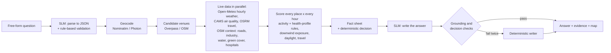

# GeoAI Outdoor Planner

An assistant that answers *"where and when should I go outdoors, and what should I keep in mind?"* for a specific
person, by reasoning over **place and time together** with **live** map, weather and air-quality data. The language
component is a **small open model (Qwen3.5-2B, 1.88B parameters in text mode) with a LoRA adapter**, run locally.

> GeoAI Hackathon @ CSRE, IIT Bombay, 2026

| | |
|---|---|
| **Live API endpoint** | `https://express-gmbh-constitutional-compromise.trycloudflare.com/ask` |
| **Web UI (permanent link)** | https://namasteworld-geoai-outdoor-planner.static.hf.space (always finds the current API address) |
| **If the API address ever changes** | the current one is always at https://namasteworld-geoai-outdoor-planner.static.hf.space/backend.json |
| **Model on Hugging Face** | https://huggingface.co/NamasteWorld/geoai-outdoor-qwen3.5-2b-lora |
| **Base model** | [`Qwen/Qwen3.5-2B`](https://huggingface.co/Qwen/Qwen3.5-2B) (Apache-2.0) |

## Try it

```bash
curl -s https://express-gmbh-constitutional-compromise.trycloudflare.com/ask -H 'Content-Type: application/json' \
     -d '{"query": "Is Saturday or Sunday better for a hike near Lonavala?"}' | jq .answer

# or simply open in a browser
https://express-gmbh-constitutional-compromise.trycloudflare.com/ask?q=Where+can+I+go+running+tomorrow+evening+near+Koregaon+Park
```

A response contains:

| field | what it is |
|---|---|
| `answer` | the reply (Markdown), written by the SLM, or by the deterministic writer if the SLM output fails a check |
| `answer_source`, `grounding` | `slm` or `template`, and the result of the grounding / decision checks |
| `understood` | what was parsed: activity, place, radius, time window, health profile, question type |
| `recommendations` | top 3 place-and-time options with score, conditions, reasons, cautions, and the place's context (nearest major road, industry, green cover, water, hospital) |
| `by_day`, `avoid`, `exact_hour_check`, `downwind_insight` | day comparison, hours to avoid and why, verdict at a requested hour, and the place-and-hour wind story |
| `advice` | what to carry and what to watch for |
| `sources` | every external request made for this answer (URL, time, cached or not) |
| `geojson`, `map_url` | the options on a map |

Other endpoints: `GET /health`, `GET /activities`, `GET /map/{id}`.

## How it works



**Why this split.** A model with fewer than 3B parameters cannot reliably do arithmetic over 10 places x 48 hours,
and it must not answer from memory. So the numeric reasoning is transparent code, and the SLM does what it is good at:
understanding messy questions, and turning a fact sheet into a clear answer for that person.

**Place x time.** Every candidate venue is scored for every hour of the requested window: apparent temperature vs.
the activity's comfort band, rain probability and amount, thunderstorm risk (WMO code, CAPE), wind and gusts, UV,
US AQI / PM2.5, daylight (and whether the venue is lit), travel time with a rush-hour multiplier, and **downwind
exposure**. For downwind exposure, the bearing from each nearby motorway, trunk or primary road and industrial site to the venue
is compared with that hour's wind direction, weighted by distance, source type, wind speed and time-of-day traffic.
That is how the assistant can say *"at 08:00 this ground is downwind of the expressway; by 18:00 the wind has shifted"*.

**Health profiles.** Asthma, senior, child, pregnancy and heart conditions tighten heat limits and air-quality limits
(following US-EPA activity guidance: sensitive groups avoid heavy exertion above US AQI 150, everyone above 200),
prefer daylight, shorten acceptable travel, and add profile-specific advice (e.g. nearest hospital in OSM).

**Grounding, enforced.** Before an SLM answer is returned, it is checked so that every number, every place-like name,
every day word ("today", "Saturday") and every air-quality adjective matches the fact sheet, and its opening carries the
same decision as the computed one (go / not recommended / yes / no / which day). Otherwise the model retries once, then a
deterministic writer answers. Every response lists the exact API calls it used.

**Messy questions.** Missing place gets a clarifying question; missing time defaults to the next 48 hours, and the answer says so;
vague times ("this weekend", "tmrw evng", "after work") are resolved deterministically. A window that has already passed
rolls to tomorrow; dates beyond the forecast horizon are declined; unsupported activities and off-topic questions are
declined politely instead of guessed.

## Activities and profiles

Running/jogging · Cycling (leisure or commute) · Golf · Cricket · Football / five-a-side · Tennis · Hiking / nature
walk · Walk / stroll · Picnic / park outing · Outdoor event (wedding, party, fair) · Outdoor photography (golden hour,
haze, cloud).
Profiles: asthma/respiratory, senior, children, pregnancy, heart condition / high blood pressure.

## Model

* **Base:** `Qwen/Qwen3.5-2B` (Apache-2.0), loaded text-only with `AutoModelForCausalLM` (1.88B parameters).
* **Adapter:** LoRA r=16, alpha=32, on attention, linear-attention and MLP projections; trained for 2 epochs on
  ~2,160 parsing and ~390 answer-writing examples on one RTX 4000 Ada (20 GB).
* **Training data:** generated programmatically. No other LLM was used to create it:
  * *parsing:* questions assembled from templates (activities x 150+ Indian places x time phrases x distances x
    profiles x question types, plus lowercase/slang/missing-field/out-of-scope noise); labels known by construction;
  * *answer writing:* fact sheets from real pipeline runs (live Open-Meteo, OSRM, Nominatim; offline OSM index), with
    weather-scenario augmentation (monsoon, thunderstorms, heatwave, winter fog, smog, wind) applied to the fetched
    values, so the model also sees conditions late October doesn't offer. Targets come from the deterministic reference
    writer and must pass the same grounding and decision checks used at run time.
  * The rulebook's example questions are excluded from training.
* **Evaluation:** see [Evaluation](#evaluation).

Load it:

```python
from transformers import AutoModelForCausalLM, AutoTokenizer
from peft import PeftModel
base = AutoModelForCausalLM.from_pretrained("Qwen/Qwen3.5-2B", dtype="bfloat16")
model = PeftModel.from_pretrained(base, "NamasteWorld/geoai-outdoor-qwen3.5-2b-lora")
tok = AutoTokenizer.from_pretrained("Qwen/Qwen3.5-2B")
```

## Data sources (all free and open, fetched live per question)

| Source | Used for | Terms |
|---|---|---|
| [OpenStreetMap](https://www.openstreetmap.org) via [Overpass API](https://overpass-api.de) | venues, roads, industry, water, green cover, power lines, hospitals | ODbL, © OpenStreetMap contributors |
| [Geofabrik](https://download.geofabrik.de/asia/india.html) India extract | offline fallback index when Overpass is overloaded (each answer says which was used) | ODbL |
| [Nominatim](https://nominatim.org), [Photon](https://photon.komoot.io) | geocoding | OSM data, usage policies respected (1 req/s, cache) |
| [Open-Meteo Forecast API](https://open-meteo.com) | hourly weather, sunrise/sunset | CC BY 4.0 |
| [Open-Meteo Air Quality API](https://open-meteo.com/en/docs/air-quality-api) (CAMS) | hourly US AQI, PM2.5, PM10, NO2, O3 | CC BY 4.0, CAMS |
| [OSRM](https://project-osrm.org) (router.project-osrm.org, routing.openstreetmap.de) | travel time and distance | usage policies respected (cache) |

All responses are cached on disk (geocoding 30 days, OSM 7 days, weather 30 min, AQ 1 h). Weather requests are made
once per forecast grid cell rather than once per venue, to stay well inside free quotas.

## Run it yourself

```bash
python3 -m venv .venv && .venv/bin/pip install -r requirements.txt

# optional but recommended: offline OSM fallback (Overpass is often overloaded)
mkdir -p data/osm && curl -L -o data/osm/india-latest.osm.pbf https://download.geofabrik.de/asia/india-latest.osm.pbf
.venv/bin/python scripts/build_osm_index.py data/osm/india-latest.osm.pbf data/osm/osm_index.sqlite   # ~4 min

GEOAI_MODEL=Qwen/Qwen3.5-2B GEOAI_ADAPTER=NamasteWorld/geoai-outdoor-qwen3.5-2b-lora \
  .venv/bin/uvicorn app.main:app --host 0.0.0.0 --port 8000
```

Configuration (environment variables): `GEOAI_MODEL`, `GEOAI_ADAPTER`, `GEOAI_OSM_MODE` (`auto` | `live` | `local`),
`GEOAI_OVERPASS_WAIT` (seconds a request waits for Overpass, default 12), `GEOAI_NO_LLM=1` (rules + deterministic writer only).

Reproduce the fine-tune:

```bash
.venv/bin/python finetune/gen_parse.py finetune/data/parse.jsonl 2400
GEOAI_OSM_MODE=local .venv/bin/python finetune/gen_narrate.py finetune/data/parse.jsonl finetune/data/narrate.jsonl 700
.venv/bin/python finetune/train_lora.py --out finetune/out/geoai-qwen3.5-2b-lora
.venv/bin/python finetune/eval.py --adapter finetune/out/geoai-qwen3.5-2b-lora
```

## Evaluation

**Held-out synthetic data** (200 parsing, 37 answer-writing examples; same checks as production):

| | Base Qwen3.5-2B, few-shot prompts | Base + LoRA, zero-shot prompts |
|---|---|---|
| Parse: valid JSON | 100.0% | 100.0% |
| Parse: activity correct | 77.0% | 100.0% |
| Parse: place correct | 99.0% | 100.0% |
| Parse: health profile correct | 93.5% | 100.0% |
| Parse: question type correct | 58.0% | 100.0% |
| Parse: all key fields correct | 71.5% | 100.0% |
| Answer: grounding check passed | 75.7% | 100.0% |
| Answer: decision check passed | 86.5% | 100.0% |
| Answer: both passed | 64.9% | 100.0% |

The held-out set comes from the same generators as the training data, so it measures how well the model learned the
task format, not robustness to arbitrary phrasing. The end-to-end test below is the more honest measure.

**End-to-end, 30 varied real-world questions** through the live system (10 rulebook examples, 14 other cities and phrasings, 6 messy or out-of-scope),
`scripts/eval_queries.py`:

| | Base, few-shot | Base + LoRA |
|---|---|---|
| Questions answered without error | 30 / 30 | 30 / 30 |
| Recommendation questions answered by the SLM *and* passing all checks | 20 / 24 | 24 / 24 |
| Clarify / decline / beyond-horizon handled gracefully | 6 / 6 | 6 / 6 |
| Median latency (RTX 4000 Ada) | 12.2 s | 8.6 s |

## Limitations

* **No live traffic.** None of the allowed free sources provides it. Travel times are OSRM free-flow times with a
  time-of-day congestion multiplier, and traffic exposure uses road class x a typical Indian-city traffic profile.
* **Downwind exposure is an estimate** from OSM geometry and forecast wind, not a pollution measurement. It shifts
  rankings between places and hours but is capped so it cannot dominate.
* **Air-quality forecasts** are CAMS model output at ~40 km resolution and reach ~5 days ahead; city-scale hotspots are
  not resolved. Beyond 5 days, hours are scored without AQI and the answer says so.
* **OSM completeness varies:** some venues are unnamed, mis-tagged or missing; whether a venue is lit (`lit=yes`) is often unknown;
  access rules (private clubs) are only as good as the tags.
* **Overpass availability:** public servers were overloaded during development; the offline Geofabrik index is a
  dated snapshot (stated in each answer that uses it).
* **The SLM can still phrase things imperfectly** (e.g. a comparison word); the checks catch invented numbers,
  places, days, AQI labels and wrong decisions, but not every nuance of wording.
* Thresholds are transparent rules of thumb, not medical advice.

## Disclosure

* **Model:** Qwen/Qwen3.5-2B + our LoRA adapter (above). No hosted LLM is used by the running assistant.
* **Data:** the sources listed above, nothing else.
* **Libraries:** FastAPI, Uvicorn, httpx, PyTorch, Transformers, PEFT, flash-linear-attention, pyosmium, timezonefinder, Leaflet, marked.
* **Tools:** __TOOLS_DISCLOSURE__

## License

Code: Apache-2.0. Map data © OpenStreetMap contributors (ODbL). Weather data © Open-Meteo.com (CC BY 4.0).
